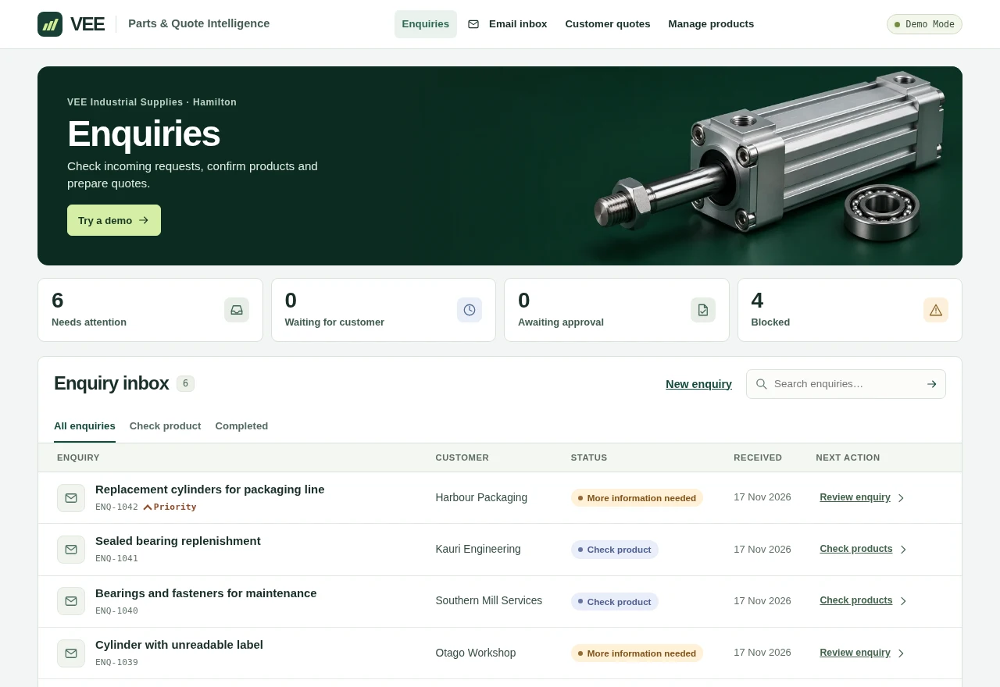
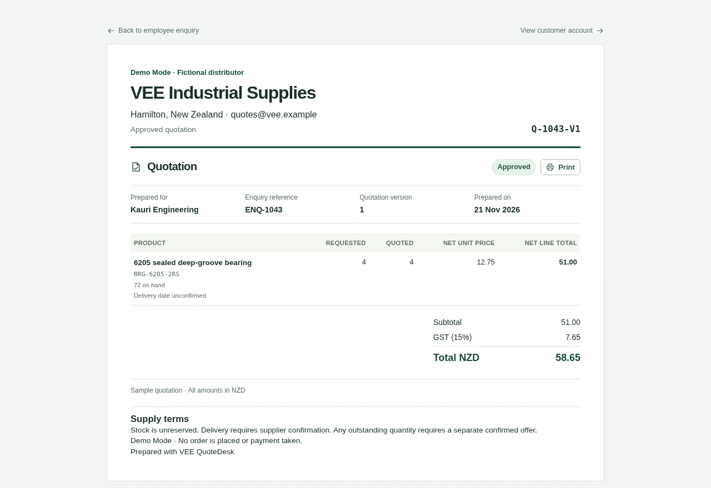
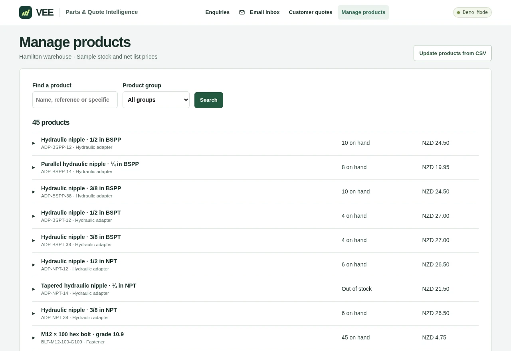

# VEE QuoteDesk

**Industrial parts enquiry and quotation software**

VEE QuoteDesk helps industrial parts distributors turn customer enquiries into quotations. It brings the customer’s request, product specifications, stock and pricing together so the sales team can check what it can offer before quoting.



## Overview

A customer asking for a replacement cylinder may know where it fits but have no readable part number. Before giving a price, the salesperson needs to establish which cylinder the customer needs and whether the warehouse can supply it.

QuoteDesk keeps that work in one enquiry. An employee can compare possible matches, ask for a missing measurement and use the confirmed details to prepare a quote. The original message and subsequent decisions stay with the record.

## Features

- **Enquiry tracking.** See which requests need attention and keep questions and replies in the same conversation.
- **Product matching.** Check part references and specifications against the catalogue. Missing details and conflicting requirements are flagged for review.
- **Product management.** Search warehouse products, inspect stock and prices, and review proposed CSV updates before applying them.
- **Quotation control.** Calculate NZD prices and GST, compare requested and quoted quantities, and retain previous versions. Extra units require customer confirmation before approval.
- **Customer quotations.** View and print the current approved quote for a selected customer.

## Screenshots

**Enquiry review** · The employee can see which cylinder specifications are missing and review the question for the customer.


**Quotation review** · Requested units, quoted units, prices and GST appear together before approval.


**Customer quotation** · The approved document shows the issuing distributor, the agreed quantities and the supply terms.



**Product management** · Employees can search the warehouse by name or part reference and filter by product group.



## How It Works

1. A customer enquiry records the parts and quantities requested.
2. QuoteDesk suggests catalogue matches and highlights details that need checking.
3. The employee resolves open questions, confirms the product and reviews stock and pricing.
4. The employee prepares a quotation and approves the version the customer can view.

## Technology

Python, Flask and Jinja power the web interface. SQLite stores enquiries, conversations and quotation history. By default, QuoteDesk uses offline rules to interpret requests and match parts. Optional OpenAI extraction requires the SDK, an API key and explicit configuration. A live request runs only when an employee submits a selected message for processing.

## Getting Started

With Python 3.12 installed on Linux or macOS, run these commands from the repository folder:

```sh
python3.12 -m venv .venv
.venv/bin/python -m pip install -r requirements.txt
.venv/bin/python -m vee.web
```

Open [the local dashboard](http://127.0.0.1:5050). The first run creates a sample workspace on your computer. Restarting the app keeps your changes. The default setup needs no API key.

## Project Status

VEE QuoteDesk by VEE AI Software is a working local prototype. Customers, emails, catalogue entries, prices and stock are fictional. Employees approve quotations within the prototype. Live email delivery, stock reservations and production sign-in are outside its scope.

## Licence

VEE QuoteDesk has no project-wide reuse licence. Its dependencies retain their own licences.
