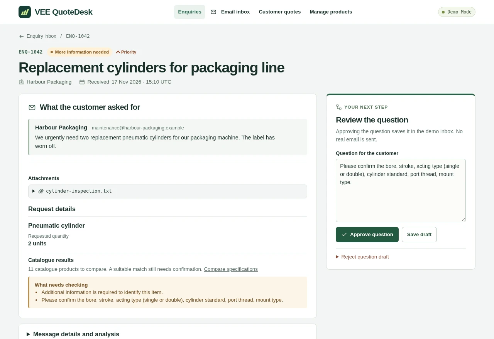
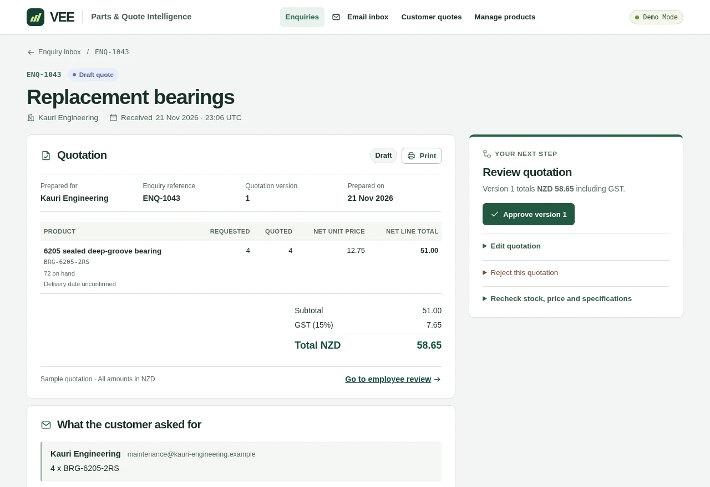

# VEE Parts & Quote Intelligence

A sales-desk prototype for industrial parts distributors. An enquiry such as “two replacement cylinders for our packaging line” gives a salesperson a quantity but too little information to quote safely. VEE puts the original request, missing specifications, catalogue evidence and quotation decision in one local workspace.


**Project status:** V7 portfolio and customer-discovery demonstration from VEE AI Software. The six customer accounts, emails, 45 warehouse products, prices and stock levels are fictional. The matching rules, employee approvals, NZD calculations and saved quotation history run locally.

## Run locally

Use Python 3.12 on Linux or macOS. From the cloned repository:

```sh
python3.12 -m venv .venv
.venv/bin/python -m pip install -r requirements.txt
.venv/bin/python -m vee.web
```

Open **http://127.0.0.1:5050**. First startup creates six enquiries in `vee/instance/workspace.sqlite3`. Restarting keeps your work. To choose another database, set `VEE_DATABASE` to its path before starting. Stop the server with Ctrl+C. The default setup needs no account, API key or environment file.

## Try a demonstration

Choose **Try a demo**, pick a scenario and select **Start scenario**. Each scenario opens a separate sample workspace. Choose **Return to original workspace** when finished.

| Scenario | What to try |
| --- | --- |
| Simple parts quotation | Confirm four bearings, review the list price and approve NZD 58.65 including GST. |
| Missing product information | Ask for cylinder dimensions, record the reply, check the match and quote NZD 316.25. |
| Not enough stock | Quote six of ten bearings for NZD 67.62 and keep four outstanding. |
| Incompatible product | Inspect a 350-bar requirement against a 250-bar rating. The conflict blocks approval. |
| Customer changes an order | Record the revised request, recheck the part and approve NZD 474.38. The earlier version remains in history. |

For a five-minute presentation or screen recording, follow the timed cylinder walkthrough. [Presenter script](SHOWCASE.md)

## From request to customer quote

1. Read the original message. Deterministic rules compare references, quantities and supported attributes against the catalogue. An uncertain match goes to employee review.
2. Approve a question in the simulated conversation and record the reply. Replaying a delivery preserves the existing thread.
3. Confirm the product, review available units and prices, and create a draft. Approval of extra units requires a confirmed customer revision and fresh checks.
4. Preview the current approved quotation for the selected fictional account and print it on A4. **Manage products** shows stock and specifications. In an isolated demo, an employee can preview and activate a synthetic CSV update.

| Missing cylinder specifications | Bearing quotation awaiting approval |
| --- | --- |
|  |  |

[Approved customer document](docs/images/customer-quote.webp) · [Warehouse product directory](docs/images/warehouse.webp) · [Employee walkthrough](docs/WORKFLOWS.md) · [CSV format and activation](CATALOGUE_IMPORT.md)

## Implementation and limits

Python 3.12, Flask and Jinja serve the employee interface. SQLite stores enquiries, audit events and quote versions. Decimal arithmetic calculates NZD totals with 15% GST. Playwright runs browser checks in Chromium.

Default processing works offline after installation. Optional live OpenAI extraction requires the optional SDK, an API key, explicit configuration and an employee submitting the selected message for live processing. This can incur API charges. Offline mock extraction is available for demonstrations. [Processing options](docs/WORKFLOWS.md#optional-live-extraction)

Use synthetic records on a trusted local computer. Account selection demonstrates customer views. There is no production identity system, real email dispatch, ERP reservation, payment, or live delivery commitment. Photos are available for employee inspection. The synthetic evaluations measure regression behavior on labelled fixtures. Accuracy on independently labelled distributor enquiries is unmeasured.

## Verify the build

```sh
.venv/bin/python -m pip install -r requirements-dev.txt -r requirements-browser.txt
.venv/bin/ruff check vee tests scripts evaluation
.venv/bin/mypy --check-untyped-defs vee evaluation
.venv/bin/python -m unittest discover -v
.venv/bin/python -m evaluation.run
.venv/bin/python -m evaluation.enquiries
.venv/bin/python -m playwright install chromium
.venv/bin/python -m scripts.browser_smoke
```

The browser suite also supports a locally installed Chromium. On a minimal Linux machine, Playwright may need system browser dependencies. Tests use temporary synthetic databases. [Test results](TEST_PLAN.md) · [Architecture and recovery](ARCHITECTURE.md)

## Licence status

The repository currently grants no project-wide reuse licence. The owner is reviewing the distribution terms. Dependency licences apply separately. [Release and rights review](docs/RELEASE-REVIEW.md)
